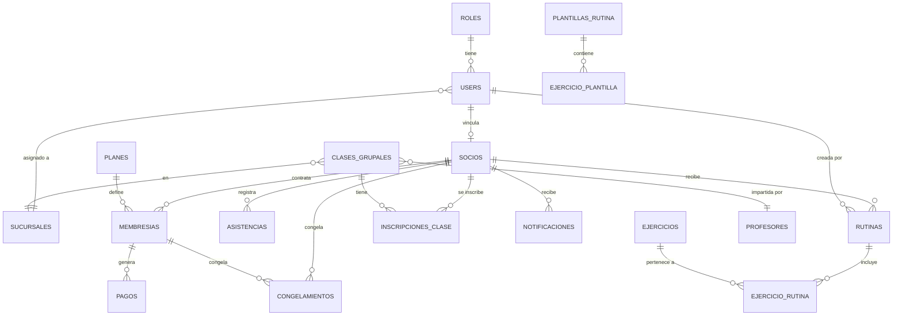

# 📋 Documentación Técnica Completa — FitLife Gym Management System

> Sistema integral de gestión para cadenas de gimnasios desarrollado con **Laravel 12 + React 19 + Inertia.js v2 + Tailwind CSS v4 + PostgreSQL**.

---

## 1. Visión General del Proyecto

**FitLife** es un sistema web completo (SPA) que permite administrar todos los aspectos operativos de una cadena de gimnasios con múltiples sucursales:

- **Gestión de Socios**: Alta, baja, edición, búsqueda, y generación automática de miembros.
- **Control de Acceso Biométrico**: Torniquetes inteligentes con validación en tiempo real (QR, código, biométrico).
- **Membresías y Planes**: Suscripciones por tiempo o sesiones, congelamiento, cuotas, morosidad.
- **Rutinas de Entrenamiento**: Creación, asignación y seguimiento de programas de ejercicios personalizados.
- **Clases Grupales**: Programación, inscripción, control de cupos y políticas por tipo de plan.
- **Dashboard Analítico**: Centro de mando con métricas en tiempo real, gráficos y alertas.
- **Portal de Autoservicio**: Interfaz para que los socios consulten su credencial digital, rutinas y asistencias.
- **Multi-Sucursal**: Soporte completo para 3+ sedes con ocupación y reportes independientes.

### Datos en el Sistema
| Métrica | Cantidad |
|---------|----------|
| Socios registrados | 1,500 |
| Rutinas de entrenamiento | 1,748 |
| Ejercicios asignados (pivote) | 8,855 |
| Ejercicios en catálogo | 35 |
| Grupos musculares | 7 |
| Entrenadores/Coaches | 5 |
| Sucursales | 3 |
| Planes de membresía | 3 |
| Tests automatizados | 76 (377 assertions) |
| Rutas registradas | 80 |

---

## 2. Stack Tecnológico

### Backend
| Tecnología | Versión | Propósito |
|---|---|---|
| **PHP** | 8.2 | Lenguaje del servidor |
| **Laravel** | 12.69.2 | Framework MVC principal |
| **PostgreSQL** | — | Base de datos relacional (producción/desarrollo) |
| **SQLite** | `:memory:` | Base de datos para tests (en memoria) |
| **Eloquent ORM** | — | Mapeo objeto-relacional, relaciones, scopes |
| **Laravel Herd** | — | Servidor local (`fitlife.test`) |
| **Inertia.js (server)** | ^2.0 | Bridge server-side que conecta Laravel con React |
| **Ziggy** | ^2.4 | Expone rutas de Laravel en JavaScript |
| **FakerPHP** | ^1.23 | Generación de datos realistas para seeders y tests |

### Frontend
| Tecnología | Versión | Propósito |
|---|---|---|
| **React** | 19 | Librería de interfaz de usuario (SPA) |
| **TypeScript** | ^5.7 | Tipado estático en frontend |
| **Inertia.js (client)** | ^2.0 | SPA sin API REST separada |
| **Tailwind CSS** | v4 | Framework de utilidades CSS |
| **Radix UI** | — | Primitivos de UI accesibles (Dialog, Dropdown, Select, etc.) |
| **Headless UI** | ^2.2 | Componentes headless para React |
| **Lucide React** | ^0.475 | Iconografía SVG |
| **Chart.js** | CDN | Gráficos interactivos (área, donut) |
| **Vite** | 6 | Bundler y servidor de desarrollo |

### Calidad y Testing
| Tecnología | Propósito |
|---|---|
| **PHPUnit** | Framework de testing (76 tests) |
| **Laravel Pint** | Formateador de código PHP (PSR-12 + Laravel) |
| **ESLint + Prettier** | Linting y formateo JS/TS |

---

## 3. Arquitectura del Proyecto

### Patrón Arquitectónico
```
┌─────────────────────────────────────────────────────┐
│                    NAVEGADOR                         │
│         React 19 + Tailwind CSS v4 (SPA)            │
├─────────────────────────────────────────────────────┤
│              INERTIA.JS v2 (Bridge)                  │
│      Sin API REST — Renderizado server-side          │
├─────────────────────────────────────────────────────┤
│                 LARAVEL 12                            │
│   Controllers → Models → Eloquent ORM → PostgreSQL   │
│   Middleware → Form Requests → Seeders → Factories    │
└─────────────────────────────────────────────────────┘
```

**¿Cómo funciona Inertia.js?**
- No se usa una API REST tradicional. Los controladores de Laravel devuelven `Inertia::render('pagina', $datos)` en lugar de vistas Blade.
- Inertia envía los datos como props JSON directamente a los componentes React.
- La navegación entre páginas es tipo SPA (sin recargar la página completa), pero las rutas se definen en Laravel.

### Estructura de Directorios (Relevantes)
```
fitlife/
├── app/
│   ├── Http/
│   │   ├── Controllers/           # 11 controladores
│   │   ├── Middleware/            # 2 middleware personalizados
│   │   └── Requests/              # Form Requests de validación
│   ├── Models/                    # 13 modelos Eloquent
│   └── Providers/                 # Service providers
├── bootstrap/
│   ├── app.php                    # Configuración de middleware y rutas
│   └── providers.php              # Registro de providers
├── config/                        # Archivos de configuración Laravel
├── database/
│   ├── factories/                 # 7 factories para tests
│   ├── migrations/                # ~15 migraciones de BD
│   └── seeders/                   # 11 seeders de datos
├── resources/
│   ├── css/app.css                # Tailwind v4 + variables de diseño
│   ├── js/
│   │   ├── app.tsx                # Entry point de la SPA
│   │   ├── pages/                 # ~18 páginas React
│   │   ├── layouts/               # Layouts (app, auth, settings)
│   │   ├── components/            # Componentes reutilizables
│   │   └── types/                 # Tipos TypeScript
│   └── views/
│       └── home.blade.php         # Landing page pública (Blade)
├── routes/
│   ├── web.php                    # Rutas web principales
│   ├── api.php                    # Endpoints API (terminales biométricos)
│   ├── auth.php                   # Rutas de autenticación
│   └── settings.php               # Rutas de configuración de usuario
└── tests/                         # 10 archivos de tests (76 tests)
```

---

## 4. Base de Datos — Modelos y Relaciones

### 4.1. Diagrama Entidad-Relación



### 4.2. Modelos Eloquent Detallados

#### `User` — Usuario del Sistema
- **Tabla:** `users`
- **Campos:** `id`, `name`, `email`, `password`, `rol_id`, `sucursal_id`, `remember_token`, `email_verified_at`
- **Relaciones:**
  - `belongsTo(Rol)` — Rol del usuario (admin, entrenador, socio)
  - `belongsTo(Sucursal)` — Sucursal asignada
  - `hasOne(Socio)` — Ficha de socio vinculada
- **Métodos clave:**
  - `esAdmin(): bool` — Verifica si es administrador
  - `esEntrenador(): bool` — Verifica si es coach
  - `esSocio(): bool` — Verifica si es socio

#### `Rol` — Roles del Sistema
- **Tabla:** `roles`
- **Roles definidos:** `admin` (ID 1), `entrenador` (ID 2), `socio` (ID 3)
- **Relación:** `hasMany(User)`

#### `Socio` — Miembro del Gimnasio
- **Tabla:** `socios` (con soft deletes)
- **Campos:** `id`, `user_id`, `codigo` (ej: SOC-0001), `nombre`, `apellido`, `dni`, `correo`, `telefono`, `direccion`, `fecha_nacimiento`, `foto`, `estado`, `observaciones_medicas`
- **Estados posibles:** `activo`, `inactivo`, `moroso`, `bloqueado`
- **Relaciones:**
  - `belongsTo(User)` — Cuenta de usuario
  - `hasMany(Membresia)` — Historial de membresías
  - `hasOne(Membresia) [membresiaActiva]` — Membresía vigente
  - `hasOne(Membresia) [ultimaMembresia]` — Última membresía
  - `hasMany(Rutina)` — Rutinas de entrenamiento
  - `hasMany(Asistencia)` — Registro de asistencias
  - `hasMany(InscripcionClase)` — Inscripciones a clases
  - `hasMany(CongelamientoMembresia)` — Congelamientos
  - `hasMany(NotificacionMembresia)` — Notificaciones
- **Scopes:**
  - `scopeActivos()` — Filtra socios activos
  - `scopeInactivos()` — Filtra inactivos
  - `scopeMorosos()` — Filtra morosos
  - `scopeBuscar($termino)` — Búsqueda por nombre, apellido, DNI, correo o código
  - `scopeConMembresiaVencida()` — Sin membresía activa vigente
- **Métodos de negocio:**
  - `tieneMembresiaActiva(): bool` — Verifica acceso válido
  - `tieneAccesoValido(): bool` — Evaluación completa de acceso
  - `congelarMembresia($dias, $motivo): ?CongelamientoMembresia` — Congela membresía
  - `reanudarMembresia(): bool` — Reanuda membresía congelada
  - `generarRutinaAutomatica($objetivo, $nivel, $entrenadorId): Rutina` — Genera rutina personalizada
  - `asignarRutinaDesdePlantilla($plantilla, $entrenadorId): Rutina` — Asigna rutina desde plantilla
  - `cuotasVencidasCount(): int` — Cuotas impagas
  - `esMorosoBloqueado(): bool` — Si tiene 2+ cuotas vencidas
  - `asistenciaAbiertaHoy(): ?Asistencia` — Check-in sin salida hoy
- **Accesor:** `nombre_completo` — Nombre + Apellido

#### `Plan` — Planes de Membresía
- **Tabla:** `planes`
- **Campos:** `id`, `nombre`, `descripcion`, `precio`, `duracion_dias`, `tipo`, `sesiones_totales`, `horario_inicio`, `horario_fin`, `permite_clases_grupales`, `recargo_clase`, `activo`
- **Planes definidos:**
  - **Plan Básico** (\$29/mes) — Horario 08:00-18:00, sin clases grupales
  - **Plan Completo** (\$49/mes) — Horario ilimitado, clases con recargo \$10
  - **Plan Premium** (\$79/mes) — Acceso 24/7, todas las clases gratis, 3 sucursales
- **Scope:** `scopeActivos()` — Filtra planes activos

#### `Membresia` — Suscripciones
- **Tabla:** `membresias`
- **Campos:** `id`, `socio_id`, `plan_id`, `sucursal_id`, `tipo`, `fecha_inicio`, `fecha_fin`, `precio_pagado`, `estado`, `metodo_pago`, `sesiones_totales`, `sesiones_restantes`, `cuotas_totales`, `cuotas_pagadas`, `saldo_pendiente`, `notas`
- **Estados:** `activa`, `vencida`, `congelada`, `cancelada`
- **Relaciones:** `belongsTo(Socio)`, `belongsTo(Plan)`, `belongsTo(Sucursal)`, `hasMany(Pago)`, `hasMany(CongelamientoMembresia)`
- **Métodos:**
  - `estaCongelada(): bool`
  - `esPorSesiones(): bool`
  - `tieneSesionesDisponibles(): bool`
  - `congelar($dias, $motivo, $soporte): CongelamientoMembresia`
  - `reanudar(): bool`

#### `Asistencia` — Control de Acceso
- **Tabla:** `asistencias`
- **Campos:** `id`, `socio_id`, `sucursal_id`, `registrado_por`, `fecha_hora`, `fecha_hora_entrada`, `fecha_hora_salida`, `tiempo_permanencia_minutos`, `metodo` (qr/codigo/biometrico), `estado_acceso` (permitido/denegado_*), `mensaje_acceso`, `clase_grupal_id`
- **Scopes:** `scopeHoy()`, `scopePermitidas()`, `scopeAbiertas()`, `scopeDenegadas()`
- **Lógica de Check-out:** Al registrar salida, calcula automáticamente `tiempo_permanencia_minutos`

#### `Rutina` — Programa de Entrenamiento
- **Tabla:** `rutinas`
- **Campos:** `id`, `socio_id`, `creada_por`, `nombre`, `descripcion`, `nivel` (principiante/intermedio/avanzado), `nivel_dificultad`, `dias_semana` (JSON), `activa`, `estado` (Activa/Histórica/Finalizada), `fecha_inicio`, `fecha_fin`
- **Relaciones:** `belongsTo(Socio)`, `belongsTo(User, 'creada_por')`, `belongsToMany(Ejercicio)` (pivote con series, reps, descanso, tempo, notas)
- **Scopes:** `scopeActivas()`, `scopeHistoricas()`

#### `Ejercicio` — Catálogo de Ejercicios
- **Tabla:** `ejercicios`
- **Campos:** `id`, `nombre`, `grupo_muscular`, `descripcion`, `equipo_necesario`, `dificultad`, `equipamiento`
- **Grupos musculares:** pecho, espalda, piernas, hombros, brazos, core, cardio (7 grupos, 35 ejercicios)

#### `ClaseGrupal` — Clases Programadas
- **Tabla:** `clases_grupales`
- **Campos:** `id`, `nombre`, `descripcion`, `profesor_id`, `sucursal_id`, `dia_semana`, `hora_inicio`, `hora_fin`, `cupo_maximo`, `activa`, `categoria`
- **Clases disponibles:** CrossFit, Spinning Pro, Yoga Vinyasa, Box & Funcional, Powerlifting, Pilates Reformer
- **Método:** `cuposDisponiblesHoy()` — Cupo máximo menos inscritos

#### `Profesor` — Instructores
- **Tabla:** `profesores`
- **Campos:** `id`, `nombre`, `especialidad`, `telefono`, `correo`, `certificaciones`, `activo`

#### `Sucursal` — Sedes del Gimnasio
- **Tabla:** `sucursales`
- **Campos:** `id`, `nombre`, `direccion`, `ciudad`, `telefono`, `horario_apertura`, `horario_cierre`, `capacidad_maxima`, `activa`
- **Sucursales definidas:**
  1. **Sede Central** — Av. Principal #123 (06:00-23:00)
  2. **Sede Norte** — C.C. Las Cumbres (06:00-22:00)
  3. **Sede Premium** — Distrito Financiero (24/7)

#### Otros Modelos
- **`Pago`**: Registros de pagos vinculados a membresías (monto, método, referencia, comprobante)
- **`CongelamientoMembresia`**: Pausas de membresía (días, motivo, soporte documental)
- **`NotificacionMembresia`**: Alertas emitidas al socio
- **`InscripcionClase`**: Inscripciones a clases grupales con estado de asistencia
- **`PlantillaRutina`**: Plantillas reutilizables de rutinas para coaches
- **`EjercicioRutina`** (pivote): Detalle de ejercicios por rutina (series, repeticiones, descanso, tempo, RPE, notas)

---

## 5. Controladores y Lógica de Negocio

### 5.1. `DashboardController` — Centro de Mando
**Ruta:** `GET /dashboard`

Recopila y entrega todas las métricas operativas del gimnasio:
- **Métricas KPI:** Socios activos/totales, asistencias hoy, ingresos del mes, variación porcentual mensual, capacidad máxima, concurrencia actual en sala.
- **Socios en Sala:** Lista en tiempo real de socios con check-in abierto (sin salida registrada).
- **Alertas de Membresía:** Socios con membresía por vencer (≤ 5 días) o ya vencida.
- **Gráfico de Concurrencia:** Datos hora a hora (06:00-22:00) para gráfico de área.
- **Ingresos por Plan:** Desglose de facturación por tipo de plan (para gráfico donut).
- **Clases del Día:** Clases grupales programadas con instructor y cupos.
- **Sucursales:** Estado y ocupación por sede.
- **Reportes Analíticos:**
  - Altas y bajas del mes
  - Morosos (1 cuota vs 2+ cuotas/bloqueados)
  - Ocupación semanal
  - Ranking de clases y profesores
  - Recaudación por plan

### 5.2. `SocioController` — Gestión de Socios
| Método | Ruta | Descripción |
|---|---|---|
| `index` | `GET /socios` | Lista paginada con filtros, estadísticas y búsqueda |
| `create` | `GET /socios/create` | Formulario de alta |
| `store` | `POST /socios` | Registra nuevo socio con validación |
| `show` | `GET /socios/{socio}` | Expediente completo (membresía, rutinas, asistencias, navegación prev/next) |
| `edit` | `GET /socios/{socio}/edit` | Formulario de edición |
| `update` | `PUT /socios/{socio}` | Actualiza datos del socio |
| `destroy` | `DELETE /socios/{socio}` | Baja (soft delete) |
| `generarAutomatico` | `POST /socios/generar-automatico` | **Genera socio realista automáticamente** con nombre, DNI, usuario, membresía activa, pago registrado y rutina de entrenamiento asignada |

### 5.3. `AsistenciaController` — Control de Acceso
| Método | Ruta | Descripción |
|---|---|---|
| `index` | `GET /asistencias` | Log de asistencias con filtros por fecha, estado, sucursal |
| `kiosco` | `GET /asistencias/kiosco` | **Kiosco táctil** de recepción (pantalla completa para tablet/totem) |
| `escanearAccesoRapido` | `POST /asistencias/escanear` | **Endpoint principal de torniquete** — Valida acceso del socio en < 200ms |
| `registrarAcceso` | `POST /asistencias/acceso` | Registro de acceso con validación completa |
| `registrarSalida` | `POST /asistencias/check-out` | Check-out con cálculo de permanencia |
| `generarAutomatica` | `POST /asistencias/generar-automatica` | Genera asistencias demo |
| `update` | `PUT /asistencias/{id}` | Editar registro |
| `destroy` | `DELETE /asistencias/{id}` | Eliminar registro |

**Lógica de validación de acceso (torniquete):**
1. Busca socio por código o DNI
2. Verifica que el socio esté activo
3. Verifica membresía activa no vencida y no congelada
4. Verifica que no tenga 2+ cuotas vencidas (bloqueo por morosidad)
5. Si el Plan Básico tiene horario restringido, valida hora actual
6. Si hay check-in abierto del mismo día, registra **salida** automáticamente
7. Genera feedback de audio (Web Audio API): tono de éxito o error

### 5.4. `MembresiaController` — Suscripciones
| Método | Ruta | Descripción |
|---|---|---|
| `store` | `POST /membresias` | Crea nueva membresía vinculada a socio y plan |
| `congelar` | `POST /membresias/{id}/congelar` | Congela membresía (vacaciones, lesión) |
| `reanudar` | `POST /membresias/{id}/reanudar` | Reanuda membresía congelada |
| `registrarCuota` | `POST /membresias/{id}/cuotas` | Registra pago de cuota |

### 5.5. `RutinaController` — Rutinas de Entrenamiento
| Método | Ruta | Descripción |
|---|---|---|
| `index` | `GET /rutinas` | Catálogo de rutinas con ejercicios y plantillas |
| `store` | `POST /rutinas` | Crea rutina con ejercicios (series, reps, descanso) |
| `show` | `GET /rutinas/{id}` | Detalle de rutina con desglose de ejercicios |
| `update` | `PUT /rutinas/{id}` | Actualiza rutina y sincroniza ejercicios |
| `destroy` | `DELETE /rutinas/{id}` | Elimina rutina |
| `generarAutomatica` | `POST /socios/{socio}/rutinas/generar` | Genera rutina personalizada para un socio |
| `generarAutomaticaGlobal` | `POST /rutinas/generar-automatica` | Genera rutina para socio aleatorio |
| `asignarDesdePlantilla` | `POST /socios/{socio}/rutinas/plantilla` | Asigna plantilla existente |
| `guardarPlantilla` | `POST /rutinas/plantillas` | Guarda plantilla reutilizable |

### 5.6. `ClaseGrupalController` — Clases Grupales
CRUD completo de clases grupales con gestión de cupos y horarios.

### 5.7. `InscripcionClaseController` — Inscripciones
| Método | Ruta | Descripción |
|---|---|---|
| `inscribir` | `POST /clases/{id}/inscribir` | Inscribe socio validando reglas de plan |
| `confirmarAsistencia` | `PATCH /inscripciones/{id}/confirmar` | Coach marca asistencia |
| `destroy` | `DELETE /inscripciones/{id}` | Cancela inscripción |
| `index` | `GET /clases/{id}/inscripciones` | Lista de inscritos |

**Reglas de inscripción por plan:**
- **Plan Básico:** ❌ No permite clases grupales
- **Plan Completo:** ✅ Permite con recargo de \$10
- **Plan Premium:** ✅ Permite sin costo adicional

### 5.8. `PortalSocioController` — Portal del Socio
**Ruta:** `GET /mi-perfil`

Muestra el perfil del socio autenticado con su credencial digital, membresía, rutinas activas y asistencias recientes.

### 5.9. `HomeController` — Landing Page Pública
**Ruta:** `GET /`

Renderiza la página de inicio pública (`home.blade.php`) con información del gimnasio, planes, clases y sucursales.

---

## 6. Middleware y Seguridad

### `HandleInertiaRequests`
- Comparte datos globales con todas las páginas React:
  - `name`: Nombre de la aplicación
  - `quote`: Cita inspiradora aleatoria
  - `auth.user`: Usuario autenticado con su rol cargado (`$user->load('rol')`)

### `VerificarRol`
- **Alias:** `'rol'`
- **Uso:** `Route::middleware('rol:admin,entrenador')` para restringir acceso por rol
- **Lógica:**
  1. Si no hay usuario autenticado → `401 Unauthorized`
  2. Si el usuario es **admin** → Acceso total (bypass)
  3. Si el rol del usuario no está en los roles permitidos → `403 Forbidden`

### Flujo de Autenticación
1. El usuario se registra vía `/register` → Se crea `User` con rol `socio` + ficha `Socio` automática → Redirige a `/mi-perfil`
2. Login demo rápido: Botones de acceso instantáneo para Admin, Coach y Socio en la pantalla de login
3. Logout redirige a la landing page (`/`)

---

## 7. Páginas Frontend (React + Inertia)

### 7.1. Landing Page Pública (`/`)
- **Archivo:** `resources/views/home.blade.php` (Blade + Alpine.js)
- **Secciones:**
  - Header con navbar sticky, toggle dark/light mode
  - Hero con indicador de estado ("Abierto ahora"), CTA "Comenzar Ahora"
  - Credencial digital 3D interactiva (efecto tilt con perspectiva CSS)
  - Tour de instalaciones (3 sucursales con fotos, horarios, dirección)
  - Carrusel de clases grupales (CrossFit, Spinning, Yoga, Box, Powerlifting, Pilates)
  - Tabla de precios (3 planes: Básico \$29, Completo \$49, Premium \$79)
  - CTA al kiosco táctil de recepción
  - Footer completo

### 7.2. Login/Registro (`/login`, `/register`)
- **Archivo:** `resources/js/pages/auth/login.tsx`
- Pantalla dividida con fotografía y estadísticas en el lado izquierdo
- Tabs: **Iniciar Sesión** / **Crear Cuenta**
- Botones de acceso rápido demo (Admin, Coach, Socio)
- Medidor de fuerza de contraseña en tiempo real
- Selector de plan de membresía en el registro

### 7.3. Dashboard (`/dashboard`)
- **Archivo:** `resources/js/pages/dashboard.tsx` (~1,700 líneas)
- Centro de operaciones con:
  - **Barra de ocupación en tiempo real** (lime < 75%, amber 75-90%, rose > 90%)
  - **4 tarjetas KPI**: Socios activos, Afluencia hoy, Facturación mensual, Tasa de asistencia
  - **Simulador de torniquete**: Input para escanear códigos con feedback visual y auditivo
  - **Credencial digital 3D** del último socio escaneado
  - **Socios en Sala**: Lista en tiempo real con tiempo de entrenamiento
  - **Alertas de membresías** por vencer con renovación rápida
  - **Gráficos**: Concurrencia por hora (área) e ingresos por plan (donut)
  - **Protocolo de evacuación**: Botón de emergencia para check-out masivo

### 7.4. Módulo de Socios (`/socios`)
- **Index**: Tabla/tarjetas con búsqueda, filtros por estado, estadísticas, creación y generación automática
- **Show**: Expediente completo con credencial digital, membresía, asistencias, rutinas, navegación prev/next
- **Edit**: Formulario de edición con datos personales, médicos y de sucursal
- **Mi Perfil** (`/mi-perfil`): Portal autoservicio del socio con credencial, rutina y asistencias

### 7.5. Módulo de Asistencias (`/asistencias`)
- **Index**: Log de control de acceso con filtros por fecha, estado, sucursal y búsqueda
- **Kiosco** (`/asistencias/kiosco`): Interfaz fullscreen para tablet/totem con:
  - Reloj digital grande
  - Teclado numérico táctil para ingresar código/DNI
  - Modos: INGRESAR / REGISTRAR SALIDA
  - Feedback visual (banner verde/rojo) y auditivo (Web Audio API)

### 7.6. Módulo de Rutinas (`/rutinas`)
- **Index**: Catálogo con grid de rutinas, nivel, ejercicios, generador automático
- **Show**: Detalle con desglose de ejercicios (series, reps, descanso, grupo muscular, equipo)
- **Drawer de asignación**: Panel lateral para crear/editar rutinas con tabs por grupo muscular

### 7.7. Módulo de Clases (`/clases`)
- **Index**: Vista dual (admin: gestión / socio: calendario de inscripción)
- Filtros por día, sucursal, categoría
- Indicadores de cupo (barras de progreso)
- Inscripción con validación de reglas de plan

### 7.8. Configuración (`/settings/*`)
- **Perfil** (`/settings/profile`): Editar nombre, email, eliminar cuenta
- **Contraseña** (`/settings/password`): Cambiar contraseña
- **Apariencia** (`/settings/appearance`): Toggle tema claro/oscuro/sistema

---

## 8. Componentes Especializados

### `CredencialDigitalSocio`
Tarjeta de identificación digital 3D con:
- Efecto tilt interactivo (perspectiva CSS calculada por posición del cursor)
- Efecto holográfico glare
- Avatar del socio
- Chip de seguridad dorado
- Badge de estado (ACTIVO verde, VENCIDO rojo)
- Gráfico QR
- Datos del socio y plan

### `DrawerAsignarRutina`
Panel lateral deslizable para crear/editar rutinas:
- Tabs por grupo muscular (pecho, espalda, piernas, hombros, brazos, core, cardio)
- Configuración de series, repeticiones, descanso por ejercicio
- Selector de socio y notas del coach

### `BadgeVencimiento`
Badge visual de vencimiento de membresía:
- Rojo con animación pulse si ya venció
- Ámbar parpadeante si vence en ≤ 3 días
- Verde si está vigente

### `GraficoConcurrencia`
Gráfico de área con Chart.js que muestra la ocupación hora a hora (06:00-22:00) con color lime neón y cálculo de hora pico.

### `GraficoIngresosMembresias`
Gráfico donut interactivo con métrica central flotante mostrando ingresos totales y distribución por plan.

---

## 9. Reglas de Negocio Principales

### 9.1. Control de Acceso (Torniquete)
1. ✅ Socio debe estar en estado `activo`
2. ✅ Membresía debe estar `activa` y no vencida
3. ✅ Membresía no debe estar `congelada`
4. ✅ Si es por sesiones, debe tener sesiones disponibles
5. ❌ Si tiene 2+ cuotas vencidas → **Bloqueado por morosidad**
6. ⏰ Plan Básico solo permite acceso de 08:00 a 18:00
7. 🔄 Si hay check-in abierto del mismo día → Registra **salida** automática (check-out)

### 9.2. Membresías
- Se pueden **congelar** (vacaciones, lesión) con motivo y soporte documental
- Se pueden **reanudar** recalculando fechas
- Soportan pagos por **cuotas** con tracking de cuotas pagadas vs totales
- Pueden ser por **tiempo** (30, 60, 90 días) o por **sesiones** (cantidad fija)

### 9.3. Clases Grupales
- **Plan Básico:** No puede inscribirse a ninguna clase grupal
- **Plan Completo:** Puede inscribirse con recargo de \$10 por clase
- **Plan Premium:** Todas las clases sin costo adicional
- No se puede inscribir si la clase está llena (`inscritos >= cupo_maximo`)

### 9.4. Rutinas de Entrenamiento
- Al generar rutina automática, las rutinas previas activas se **archivan** (estado: Histórica/Finalizada)
- La generación selecciona ejercicios variados de distintos grupos musculares
- Al generar un socio con 1-clic, automáticamente se le asigna una rutina activa

### 9.5. Protocolo de Evacuación
- Desde el dashboard, un botón de emergencia puede cerrar todas las asistencias abiertas (check-out masivo)

---

## 10. API REST (Terminales Biométricos)

Endpoints diseñados para integración con hardware de control de acceso (torniquetes, lectores QR):

| Método | Endpoint | Descripción |
|---|---|---|
| `GET` | `/api/v1/socios/verificar/{codigo}` | Verifica socio por código/DNI y retorna estado de acceso |
| `POST` | `/api/v1/acceso` | Registra entrada/salida desde terminal |
| `POST` | `/api/asistencias/escanear` | Escaneo rápido (< 200ms) |
| `POST` | `/api/asistencias/check-out` | Check-out desde terminal |
| `GET` | `/api/clases-grupales` | Clases activas con cupos disponibles |
| `POST` | `/api/clases/{id}/inscribir` | Inscripción desde terminal |

---

## 11. Seeders y Datos de Prueba

| Seeder | Propósito |
|---|---|
| `RolSeeder` | Crea roles: admin, entrenador, socio |
| `SucursalSeeder` | Crea 3 sucursales con horarios y capacidad |
| `PlanSeeder` | Crea 3 planes: Básico, Completo, Premium |
| `EjercicioSeeder` | Crea catálogo de 35 ejercicios en 7 grupos musculares |
| `ProfesorSeeder` | Crea instructores de clases grupales |
| `DemoUsersSeeder` | Crea usuarios demo: admin@fitlife.test, coach@fitlife.test, socio@fitlife.test |
| `FitLifeMassiveSeeder` | Genera 500+ socios con membresías, asistencias, clases y rutinas |
| `FitLifeExpansionSeeder` | Datos adicionales de expansión |
| `Cargar500SociosMasSeeder` | 500 socios adicionales con membresías |
| `PoblarAsistenciasCompletasSeeder` | Asistencias históricas completas |
| `AsignarRutinasTodosSociosSeeder` | Garantiza rutina activa para el 100% de socios |

### Factories (para Tests)
| Factory | Modelo | Estados |
|---|---|---|
| `UserFactory` | User | `unverified()` |
| `SocioFactory` | Socio | `inactivo()`, `moroso()` |
| `PlanFactory` | Plan | — |
| `MembresiaFactory` | Membresia | `activa($dias)`, `vencida($dias)`, `porVencer($dias)` |
| `AsistenciaFactory` | Asistencia | `permitido()`, `denegadoCuotaVencida()` |
| `RutinaFactory` | Rutina | — |
| `PagoFactory` | Pago | — |

---

## 12. Pruebas Automatizadas (76 Tests)

### Suite de Tests
| Archivo | Tests | Categoría |
|---|---|---|
| `FitLifeClientRefactorTest` | 9 | Multi-sucursal, control acceso, morosidad, horarios, clases, rutinas, dashboard, generación auto |
| `FitLifeGymTest` | — | Tests del core del gimnasio |
| `FitLifeExpansionTest` | — | Tests de funcionalidades expandidas |
| `ClasesGrupalesModuloTest` | — | CRUD y reglas de inscripción a clases |
| `ModulosCrudYNavTest` | — | Navegación y CRUD de módulos |
| `PortalSocioTest` | — | Portal de autoservicio |
| `HomePageTest` | — | Landing page pública |
| `DashboardTest` | 4 | Acceso, métricas, props, datos seeded |
| `AuthenticationTest` | 6 | Login, logout, demo roles |
| `RegistrationTest` | 2 | Registro con creación de ficha Socio |
| `EmailVerificationTest` | 3 | Verificación de email |
| `PasswordConfirmationTest` | 3 | Confirmación de contraseña |
| `PasswordResetTest` | 4 | Reset de contraseña |
| `PasswordUpdateTest` | 2 | Actualización de contraseña |
| `ProfileUpdateTest` | 5 | Actualización/eliminación de perfil |

### Tests Clave del Negocio
1. **Multi-sucursal**: Verifica que socios, membresías y asistencias se vinculan correctamente a sucursales
2. **Check-in/Check-out**: Valida flujo completo de entrada → 60 min → salida con cálculo de permanencia
3. **Bloqueo por morosidad**: Socio con 2+ cuotas vencidas recibe `denegado_moroso`
4. **Restricción horaria**: Plan Básico denegado fuera de 08:00-18:00
5. **Reglas de clases**: Valida inscripción según tipo de plan (Básico ❌, Completo +\$10, Premium ✅)
6. **Historial de rutinas**: Verifica que al generar nueva rutina, la anterior se archiva
7. **Dashboard analítico**: Verifica presencia de los 5 reportes obligatorios
8. **Generación automática + rutina**: Socio generado automáticamente incluye membresía y rutina activa
9. **Seeder de rutinas**: Verifica que el seeder asigna rutinas a todos los socios sin una

### Ejecución
```bash
php artisan test --compact
# 76 passed (377 assertions) — Duration: ~7s
```

---

## 13. Configuración del Entorno

### Variables de Entorno (`.env`)
```env
DB_CONNECTION=pgsql
DB_HOST=127.0.0.1
DB_PORT=5432
DB_DATABASE=fitlife
DB_USERNAME=postgres
DB_PASSWORD=admin

SESSION_DRIVER=database
QUEUE_CONNECTION=database
APP_URL=http://fitlife.test
```

### Testing (`phpunit.xml`)
```xml
DB_CONNECTION=sqlite
DB_DATABASE=:memory:
BCRYPT_ROUNDS=4          <!-- Hashing rápido -->
CACHE_STORE=array
SESSION_DRIVER=array
QUEUE_CONNECTION=sync
```

---

## 14. Cómo Ejecutar el Proyecto

### Requisitos Previos
- PHP 8.2+
- Node.js 18+
- PostgreSQL
- Composer
- Laravel Herd (recomendado)

### Instalación
```bash
# 1. Instalar dependencias
composer install
npm install

# 2. Configurar entorno
cp .env.example .env
php artisan key:generate

# 3. Crear y popular base de datos
php artisan migrate --seed

# 4. Compilar frontend
npm run build

# 5. Acceder a http://fitlife.test (con Herd)
```

### Cuentas Demo
| Rol | Email | Contraseña |
|---|---|---|
| **Administrador** | admin@fitlife.test | password |
| **Entrenador** | coach@fitlife.test | password |
| **Socio** | socio@fitlife.test | password |

---

## 15. Glosario de Términos

| Término | Significado |
|---|---|
| **Socio** | Miembro/cliente del gimnasio |
| **Membresía** | Suscripción activa vinculada a un plan |
| **Plan** | Tipo de suscripción (Básico, Completo, Premium) |
| **Asistencia** | Registro de entrada/salida al gimnasio |
| **Rutina** | Programa de entrenamiento con ejercicios |
| **Clase Grupal** | Sesión de ejercicio dirigida por un instructor |
| **Kiosco** | Terminal táctil de autoservicio en la recepción |
| **Torniquete** | Sistema de control de acceso físico |
| **Congelamiento** | Pausa temporal de membresía |
| **Morosidad** | Estado de socio con cuotas impagas (2+ = bloqueado) |
| **Check-in** | Registro de entrada al gimnasio |
| **Check-out** | Registro de salida con cálculo de permanencia |
